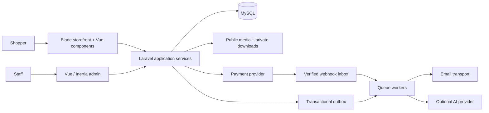

# Architecture and development conventions

Status: proposed defaults · October 5, 2026.

## Stack

| Component | Baseline | Reason |
| --- | --- | --- |
| Backend | Laravel 13.x, PHP 8.4, Composer 2 | Current supported Laravel baseline with a conservative PHP target |
| Admin | Vue 3, TypeScript strict mode, compatible stable Inertia adapter | Rich forms with Laravel routing and session authorization |
| Storefront | Blade-rendered HTML with Vue 3 interactive components | Searchable content and PHP theme support without a required Node SSR service |
| Assets | Laravel Vite integration; lock compatible stable packages during bootstrap | Build once and ship versioned static assets |
| Database | MySQL 8.4 with InnoDB and utf8mb4 | Relational commerce data and row locking; one production database target for v1 |
| Jobs/cache/sessions | Laravel database drivers initially; Redis an optional later deployment profile | Small supported installation footprint |
| Storage | Public image derivatives and private digital assets on distinct disks | Product photos and purchased files have different access rules |
| Payment | Stripe hosted Checkout, immediate payment methods only initially | Credentials stay server-side; card data stays with the provider |
| AI | Application-owned adapter; evaluate Laravel AI SDK during the early spike | Provider choice does not leak into theme/content domain |
| Tests | Pest, Vue Test Utils + Vitest, Playwright; MySQL integration environment | Domain, component, and real-browser coverage |
| Formatting/static analysis | Pint, PHPStan with Laravel support, ESLint, Prettier, vue-tsc | Repeatable quality checks |

Laravel 13 supports PHP 8.3–8.5 according to its [release notes](https://laravel.com/docs/13.x/releases); PHP 8.4 is our target, not Laravel's minimum. Vue's official tooling supports single-file components with Vite and TypeScript. Exact package versions and a compatible build-time Node version must be resolved and locked in the bootstrap task; do not assume a patch version from this planning document. [Vue tooling](https://vuejs.org/guide/quick-start.html).

No Node process is required to serve the proposed production storefront. Inertia SSR would introduce a separate runtime service; that tradeoff is why the public storefront uses Blade while the authenticated admin uses Inertia. [Inertia SSR](https://inertiajs.com/server-side-rendering).

## Application shape

A modular monolith: one repository, one Laravel deployment, one database, a queue worker and a scheduler. No microservices, event broker, GraphQL layer, generic plugin container, or speculative repository abstraction.



## Planned structure

```text
app/
  Domain/
    Platform/ Identity/ Catalog/ Pricing/ Shipping/
    ThemesContent/ CheckoutOrders/ Fulfillment/
    ShoppingTools/ Marketing/ Referrals/ SeoHubs/
    Storefront/ AiAuthoring/ Operations/
      Actions/ Contracts/ Data/ Events/ Models/ Rules/
  Http/Controllers/{Admin,Storefront,Webhooks}/
  Http/Requests/
  Http/Resources/
  Policies/
  Jobs/
  Providers/
bootstrap/
config/
database/{migrations,factories,seeders}/
resources/
  js/admin/{pages,components,layouts}/
  js/storefront/{components,composables}/
  js/shared/{types,components}/
  css/
  views/{system,mail}/
themes/default/{theme.json,views,src,dist,sections}/
routes/{web,admin,storefront,webhooks,console}.php
storage/app/{public,private}/
tests/{Unit,Feature,Contract}/
tests/Browser/
docs/
tasks/
```

Create subdirectories when used, not as empty scaffolding. Start with Laravel conventions and ordinary Eloquent models. Domain services exist for operations that need transactional correctness or a stable provider boundary; do not wrap every model method.

## Native marketing runtime

Marketing uses the same database/outbox/scheduler and configured email transport. Isolate bulk marketing and hub generation from payment and transactional-mail workers. Urgency/proof projections have bounded freshness and fail closed without blocking checkout. [Marketing rules](marketing-rules.md) define coupon/referral ownership, consent, attribution and hub publication.

## Requests, state, and permissions

- Laravel routes are canonical. Inertia drives admin navigation; storefront Vue islands call same-origin session/CSRF-protected endpoints. No bearer token stored in browser local storage.
- Staff and customers have separate login surfaces and authorization namespaces. A customer registration can never create a staff grant.
- Policies enforce entity access and permissions in controllers/actions; hiding UI is not authorization.
- Server validation uses request objects; Vue mirrors validation for usability. Cart totals, tax, inventory, refund limits and downloads are always checked server-side.
- Local component state handles transient UI. Introduce shared Vue state only for cross-component cart/watchlist/comparison behavior. Backend responses remain authoritative.
- Inertia responses and JSON endpoints use distinct framework protocols; error envelopes in [interfaces](interfaces.md) apply to JSON requests, while Inertia uses form error bags.

## Transactions and async work

Use database transactions for local business changes. Persist outbound event intent in an outbox in the same transaction as the business change; enqueue after commit and periodically recover pending rows. Use unique consumer receipt records for replay safety. Jobs are at-least-once, so their effects must tolerate redelivery. Do not promise exactly-once email delivery through ordinary SMTP.

Persist incoming verified provider events before acknowledgement. Payment network calls happen outside row-locking transactions; an explicit recorded attempt bridges the two. Unknown provider outcomes trigger reconciliation, not blind creation of a new charge. [Commerce rules](commerce-rules.md) define the lifecycle.

Laravel supports dispatch-after-commit and database/Redis queues; our outbox and reconciliation design adds recovery guarantees for commerce state. [Laravel queues](https://laravel.com/docs/13.x/queues).

## Code style

PHP: strict types for domain files, final classes by default where extension is unnecessary, typed inputs/outputs, constructor injection, backed enums for finite internal states. PSR-12/Pint formatting. Classes PascalCase; methods camelCase; SQL columns snake_case. API JSON uses camelCase and lower_snake_case enum strings. Vue uses Composition API and `<script setup lang="ts">`, explicit props/emits, and semantic HTML.

Illustrative style; this is a specification example, not application implementation:

```php
<?php

declare(strict_types=1);

namespace App\Domain\Catalog\Data;

final readonly class StockAvailability
{
    public function __construct(
        public int $onHand,
        public int $reserved,
    ) {}

    public function available(): int
    {
        return max(0, $this->onHand - $this->reserved);
    }
}
```

Commerce mutation actions must reject invalid stock states; this display object is not the stock integrity mechanism. Keep controllers small, use named domain errors, and avoid generic catch-all success responses.

## Tests and commands

The [coding handoff](coding-handoff.md) defines required executable commands and when they become available. Tests live next to their domain in the corresponding test layer. No application tests can run before scaffolding exists.

Required categories: money/allocation unit tests; MySQL lock and rollback integration tests; payment and AI contract fixtures; authorization and private-file tests; Vue validation/interaction tests; browser journeys for physical, digital, mixed, theme, AI, and install flows. See [quality targets](quality-and-operations.md) for the release bar.

## Hosting

Reference deployment: Linux VPS/container host with TLS, PHP-FPM/web server, MySQL, a continuously supervised queue worker, one scheduler invocation per minute, persistent storage, and outbound HTTPS/email. Suggested starting reference test machine: 2 vCPU, 4 GB RAM, SSD. This is a test baseline, not a proven capacity claim.

Release archives should include compiled assets and production dependencies, with checksums and version metadata. Developers build with Composer/Node; a merchant following the packaged installation guide should not need a frontend build tool. Shared hosting is supported only if it meets the full runtime requirements; no promise of compatibility with arbitrary PHP hosting.
