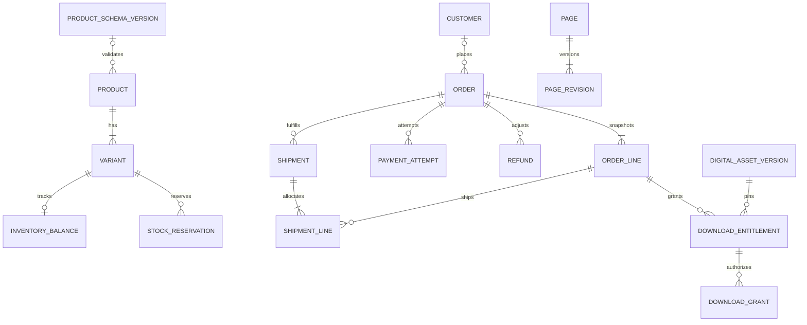

# Data model

Logical model for migrations, not a claim that tables already exist. Each group belongs to its named module. Use internal bigint primary keys and unique opaque ULID public IDs for exposed resources; opaque IDs never substitute for authorization. Use foreign keys and UTC timestamps. Restrict deletes of referenced commerce records.

## Entity groups

| Owner | Entities and essential fields | Relationships / constraints |
| --- | --- | --- |
| platform | `store_settings` typed/versioned settings; `installations` version/install lock; `media_assets` disk/key/MIME/size/checksum/status; `audit_events`; `outbox_events`; `consumer_receipts` | One settings aggregate; secret settings encrypted and redacted; unique event+consumer receipt |
| identity | `staff_users`, `roles`, `permissions`, role/permission pivots; `customers`, `customer_addresses`; framework sessions/reset tokens; `email_verifications` | Staff and customer principals separate; normalized unique emails per principal type; no privilege from matching emails |
| catalog | `products` title/slug/type/status/schemaVersionId/templateKey; `variants` sku/options/price/sale/taxClassKey/shippingClassKey/weight/dimensions; `product_categories`; `categories` parent/slug/path; `product_media` | Product 1:N variants, including one default variant for simple products; SKU unique; unique option combination; category tree acyclic |
| catalog | `product_schemas`, immutable `product_schema_versions`; `attribute_definitions` key/type/unit/comparable/filterable; `attribute_values`; `variant_options` | Published schemas immutable; explicit migration to a new version; typed indexed values, not universal text EAV |
| catalog | `inventory_balances` variant/onHand/reserved; `stock_reservations` ownerRef/variant/originalQty/shippedQty/releasedQty/remainingQty/status/expiresAt; `stock_movements` sourceRef/delta/reason | One balance per tracked variant at v1 location; unique reservation intent+variant; unique source operation movement |
| catalog | `digital_assets`, `digital_asset_versions`, `variant_digital_assets` | Private storage keys, MIME/size/hash; immutable versions; variants may grant several files; no public storage URLs |
| pricing | `coupons`, `coupon_scopes`, `coupon_holds`, `coupon_redemptions`; `tax_classes`, `tax_rules`, `pricing_settings` | Case-normalized unique code; guarded max redemptions; immutable rule revision referenced in snapshots |
| shipping | `shipping_zones`, `shipping_methods`, `shipping_rate_rules`, `shipping_classes` | Prioritized nonambiguous destination matches; minor-unit rates; integer weights in grams and dimensions in millimeters |
| themes-content | `theme_installations`, `theme_activations`, `theme_settings`; `pages`, `page_revisions`; `articles`, `article_revisions`; `menus`, `menu_items`; `layout_assignments` | Separate draft/published pointers; template keys namespaced to theme; validated internal links; optimistic revision locks |
| checkout-orders | `carts`, `cart_lines`; `checkout_quotes`; `checkout_sessions`; `idempotency_records` | Customer or hashed guest-session ownership; unique variant per cart; request hash and persisted replay status per scoped key |
| checkout-orders | `orders`, `order_lines`, `order_adjustments`, `order_addresses`; `order_events` | Public order number unique; immutable line product/variant/SKU/options/title/tax/price/type/file-version snapshots; customer FK nullable |
| checkout-orders | `payment_attempts`, `payments`, `provider_events`, `refunds`, `refund_lines` | Provider account+environment+event ID unique; provider payment/session IDs unique; immutable local attempt IDs; successful/pending refund allocation bounded by capture |
| fulfillment | `shipments`, `shipment_lines`, `returns`, `return_lines` | Shipments allocate physical quantities only; fulfilled totals cannot exceed paid, uncancelled quantities; received return quantities bounded by shipped |
| fulfillment | `download_entitlements`, `download_grants`, `download_transfers`, `guest_order_access_tokens` | Unique orderLine+assetVersion entitlement; only token hashes stored; atomic grant counters; expiry and revocation metadata |
| shopping-tools | `wishlists`, `wishlist_items`, `watch_subscriptions`, `watch_notifications`; `comparison_sessions` | Unique owner+variant save; alert type+recipient+variant unique; verified email consent; unique triggering catalog event+subscription |
| ai-authoring | `ai_runs`, `ai_drafts`, `ai_usage_reservations`, `ai_usage_entries` | Actor/provider/model/schema/baseRevision/status; bounded retained context; unique request intent and budget reservation |
| operations | `notification_deliveries`, `report_snapshots`, `export_jobs`, `maintenance_runs` | Delivery event+recipient+template unique; reports rebuildable; export artifact expires; diagnostic outputs redact secrets |

Logical keys such as tax/shipping class keys referenced by catalog avoid reverse model imports. Their existence is checked by application composition at product publication; deleting a referenced class is blocked. Published products cannot have unresolved configuration references.

Before configurable rules exist, reserved built-in keys `standard` (tax) and `general` (shipping) are valid classification labels only, not rates or authorization to sell. T029/T031 register these keys with configured methods/rates; checkout still blocks missing coverage. Other class keys require an installed registry entry. A product may have no custom schema version and use core fields alone; typed custom schemas become available in T017. This keeps the initial publish/browse slice implementable without inventing tax rates or premature schema tables.

## Core relationships

See also the marketing entity extension at the end of this document. Checkout stores opaque source references; marketing/referrals consume its events instead of creating reverse model imports.

## Attribute storage

A unique checkout-intent constraint on cart ID + revision binds retries across different idempotency keys to one order. A replacement payment attempt reuses that order only after the earlier attempt is conclusively non-payable; a new purchase has a new cart revision and confirmation.

Reservation records include original/shipped/released/remaining quantities and close only when remaining is zero. Order lines include fulfillment-held/cancelled/refunded quantities and a monotonic eligibility revision, updated before event delivery. Download grants contain start-token hash/expiry/consumedAt and transfer reference; `download_transfers` contains owner/session binding, asset version, absolute expiry, concurrency lease and active/expired/revoked state. These records support partial operations and stale-event denial as defined in [commerce rules](commerce-rules.md).

Use a stable global semantic attribute key with type and canonical unit, such as `sensor.megapixels` or `weight.grams`. Schema versions select and label these attributes. Each value has exactly one typed slot: string, decimal, integer, boolean, date, enum option, or structured list of allowed enum options. Enforce type checks in validation and test database constraints where supported. Numeric filter/sort/comparison uses typed normalized values.

Presentation-only section settings and frozen order snapshots may use JSON. Do not store searchable quantities or all money solely in unindexed JSON. An attribute's meaning/type cannot be silently changed under the same key.

## Required indexes and transaction guards

- Public products: `(status, published_at, id)`; unique slug; product/category pivot indexes both ways; full-text title/description plus explicit SKU lookup.
- Variants: unique SKU and normalized option-combination fingerprint per product. Inventory: unique variant; reservations indexed by `(status, expires_at)` and owner reference.
- Orders: unique order number/public ID; `(customer_id, created_at)`; `(status, created_at)`; payment/refund projections for reporting. Historical order-line price data never joins current product price for calculations.
- Provider event: unique `(provider, account_ref, environment, event_id)`; `(processing_state, next_attempt_at)`. Local idempotency unique `(principal_scope, operation, key)` plus request hash.
- Content: unique reserved-aware normalized path; `(publication_state, published_at)`; revisions with entity+revision unique. Slug changes record redirects, with loop checks.
- Downloads: token hash unique; entitlement owner/state/expiry indexes. Watch alerts: dedup key unique. Outbox: `(state, available_at)`.
- Enforce inventory/reservation/refund quantity bounds inside locking transactions; SQL `CHECK` constraints cover single-row bounds but cannot alone enforce cross-row aggregates.

## Retention and deletion

Archive products referenced by orders. Remove customer login access and anonymize eligible profile data on an approved request while retaining required order records under the store's configured policy. Never hard-code a universal legal retention period. Staff can export a customer's own eligible information with audit.

Default operational retention proposal: guest carts/comparisons 30 days, unpublished AI prompt/context logs 30 days, downloadable export links 24 hours. Order/payment/refund/dedup/audit retention requires store policy before launch. Keep minimal dedup tombstones if event payloads are purged. Backups have a separate documented retention and deletion lifecycle.

## Marketing expansion entities

| Owner | Entities and essential fields | Constraints / lifecycle |
| --- | --- | --- |
| platform | `delivery_contacts` normalized email/verification/customerRef; `purpose_grants` purpose/notice/source/grantedAt/revokedAt; `delivery_suppressions` scope/reason/source | Unique normalized contact; current contact+purpose version; global marketing and transport suppression distinct from essential transaction messages |
| pricing | `promotion_campaigns`, `promotion_versions`, `coupon_batches`, `coupon_grants`, `promotion_budget_holds` | Coupons remain pricing-owned; unique issuer+sourceIntent; unpredictable unique code; recipient restriction; atomic cap/discount budget holds |
| marketing | `marketing_campaigns`, `campaign_versions`, `audience_snapshots`, `campaign_send_intents`, `delivery_feedback` | Unique campaign-version+contact+step or episode+step; feedback ID unique; suppression rechecked at dispatch; unknown transport state explicit |
| marketing | `recovery_episodes` cart/activityRevision/flowVersion/status; `recovery_steps`; `recovery_tokens` hash/expiry/claimedAt | Unique cart+activityRevision; hashes only; restored cart lineage; GET does not consume token or expose cart |
| marketing | `onsite_campaigns`, `proof_aggregates` product/window/netOrderCount/refreshedAt; `product_reviews`, `review_moderation_events` | Genuine source facts; verified identity+product review unique; no private IDs in public DTOs; review/moderation revisions |
| marketing | `campaign_touches`, `marketing_events`, `order_attributions` | Bounded allowlisted UTM; one primary report attribution per order; no recovery token/address; server financial facts authoritative |
| referrals | `referral_programs`, `referral_program_versions`, `advocate_enrollments`, `referral_codes`, `referral_touches` | Verified advocate; opaque unique code; explicit expiry/precedence; no friend identity in advocate read model |
| referrals | `referral_claims`, `referral_rewards`, `referral_review_cases` | Unique program+verified friend qualification; unique qualifying order+reward type; atomic program/advocate caps; audited reversals |
| seo-hubs | `hub_rules`, `hub_rule_versions`, `hub_candidates`, `hub_memberships`, `seo_audit_findings`, `feed_runs` | Intent/rule fingerprint unique; uses existing content page/revision publication; unique hub+product; refresh/version timestamps |

Checkout adds cart lineage and immutable offer/campaign/referral/marketing-source snapshots to orders. It consumes pricing-owned eligibility and opaque source IDs; it never queries marketing/referral business models to determine payable totals. Verified identity evidence enters pricing through trusted DTOs, not browser claims.

Index recovery by state+next-step time and contact+send time; coupon grants by recipient/state/expiry; referral qualification by program+friend and order; hub membership by hub and product; SEO findings by severity/entity/status. Proposed raw interaction retention is 90 days; retain minimal suppression/dedup evidence and reward/order history under store policy. Privacy deletion must not cause a previously unsubscribed contact to be silently re-enrolled by replayed imports.
