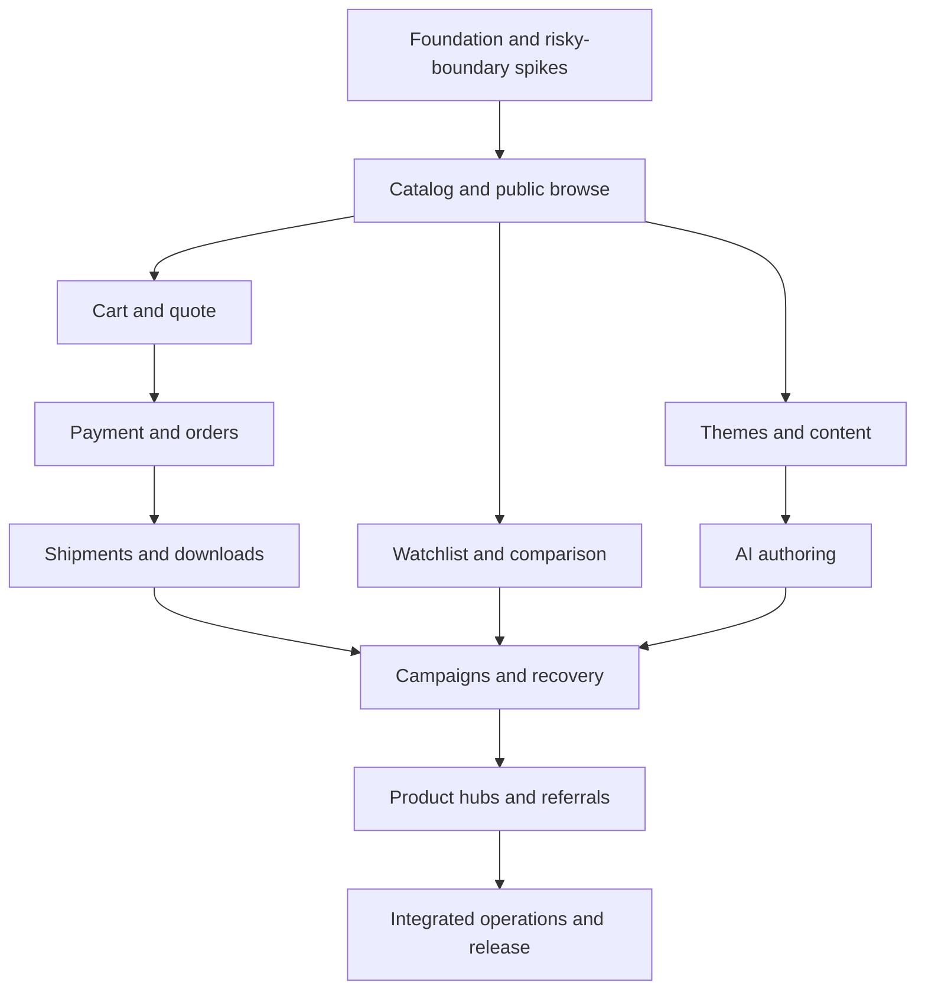

# Implementation plan

Status: audited plan, not implemented · October 10, 2026 · Revision 0.3.

## Strategy

Build small end-to-end slices inside one application. Validate the risky boundaries early: supported install/runtime, PHP/Vue theme composition, provider payment/expiry behavior, stock concurrency, and AI structured output. Then complete physical commerce, digital/mixed orders, content customization, native marketing/SEO/referrals and merchant operations. Stable milestone IDs are preserved; execution order is M0–M7 → M9 → M10 → M8.

All capabilities in SPEC.md are required for the first public release. A physical checkout demo is only an internal milestone. [The task backlog](todo.md) is the source of execution status; nothing is checked off yet.

## Milestones

| ID | Outcome | Depends on | Exit evidence |
| --- | --- | --- | --- |
| M0 | Independent repository, runnable foundation, risk spikes | — | Compatible locked stack, protected install, test commands; documented payment/theme/AI spike findings |
| M1 | Merchant publishes typed products and shoppers browse | M0 foundation/contracts; external checks may remain pending as below | Physical/digital definitions, variants, schemas, categories, public views, inventory contract |
| M2 | Correct cart, shipping, discounts and tax quotes | M1 | Deterministic pricing; mixed-cart shipping; stale quote and stock/coupon tests |
| M3 | Complete payment/order lifecycle | M2 | Hosted sandbox payment, durable event recovery, refund/cancellation, physical order journey |
| M4 | Physical fulfillment and secure digital/mixed delivery | M3 | Partial shipments/returns, verified downloads, revocation and mixed-order journey |
| M5 | Shared contact preferences, save, watch and compare | M1, identity from M0; full journey on M4 | Guest/account merge, subscribed alert delivery, typed comparison |
| M6 | Extensible themes and content | M1 and early theme spike; full commerce integration on M4 | Developer theme install, safe import, section editor, publish/rollback, SEO |
| M7 | Built-in AI authoring | M6 and early AI spike | Bounded provider run, validated draft, diff, publish permission and retry evidence |
| M9 | Native campaigns, recovery and conversion tools | M3–M7 | Purpose grants, coupons/stacking/budgets, recovery, broadcasts, genuine proof/reviews and accessible widgets |
| M10 | Product hubs, referrals and growth reporting | M9, M4, M6, M7 | Bounded SEO hubs, schema/feed checks, referral reward/reversal flow, AI copy review and attribution |
| M8 | Reports, release packaging and operational readiness | M3–M7, M9, M10 | Integrated commerce/marketing metrics, exports, install/update/restore and expanded release checklist |

## Dependency graph

Foundational security, audit, queue health, test coverage and transactional email transport are incremental requirements, not a final hardening phase. M8 verifies the integrated product and packages it after M9/M10. All original task IDs are retained. The 123-task backlog includes T003a/T004a/T004b for PHP quality, browser tooling and CI. Shared preference task T091 precedes watchlist consumers in M5; T092–T120 land in M9/M10 before final operations/release. Numeric task IDs are identifiers, not the execution order.

M0 uses synthetic payment/AI fixtures without future catalog/order tables. Missing provider credentials may leave T011/T012 external evidence pending while independent catalog/theme tasks proceed; this does not mark the spikes complete. T035 sandbox acceptance and T074 live AI verification require actual test credentials/results. M0 completion also requires the running foundation and all its stated evidence, including remote CI once a repository host is configured.

## Risk register

| Risk | Mitigation / early evidence |
| --- | --- |
| Parent Git repository has unrelated work | Establish dedicated root before staging; never commit/reset parent changes |
| Hosting assumptions exclude intended merchants | M0 reference-host preflight; state supported runtime honestly |
| Unknown provider/session behavior causes stock loss or duplicate payment | Payment spike, durable attempts, reconciliation, provider expiry cancellation tests |
| Product-schema edits invalidate comparison/search | Immutable versions, typed semantic keys, explicit migration preview |
| PHP/Vue imports become arbitrary code execution | Separate trusted code deployment from data-only merchant authoring |
| Digital files leak or remain accessible after refund | Private streaming routes, entitlement checks, atomic grants and revocation tests |
| Tax rules insufficient for first market | Confirm market before acceptance; add adapter/capabilities before enabling unsupported sales |
| AI scope grows into an unrestricted code agent | Schema-only output, no shell/tool access, selected public context, bounded usage |
| Self-hosted updates lose customizations/data | Versioned themes, compatibility check, additive migrations, upgrade/restore rehearsal |
| Reports differ from actual captured/refunded money | Immutable financial facts; explicit attribution windows and overlap-safe order totals |
| Recovery sends after purchase or opt-out | Final eligibility check, purpose suppression and durable send intents; document transport-acceptance race |
| Referral abuse or refund gaming | Verified first-customer claims, delayed rewards, atomic caps and reversal review |
| Generated hubs create duplicate/low-value pages | Bounded candidate rules, quality/indexability gates, editorial control and fresh membership |
| Marketing traffic affects payment latency | Separate worker capacity, bounded widgets and repeat integrated load test before packaging |

## Work coordination

Once provider contracts are settled, shopping tools and content/theme slices can be developed independently of payment UI. Do not concurrently edit shared migrations, route ownership, lockfiles or money/stock contracts without coordination. No sub-agents or parallel branches have been started by this planning task.

## Checkpoints and sizing

The backlog places a checkpoint after each three-task group and each milestone remainder. Tasks list likely authored files and one focused verification command. Generated framework files are the single mechanical scaffolding exception; record them separately. Split any feature task that grows beyond roughly five authored files or one focused session into lettered subtasks before coding, preserving its parent ID and acceptance criteria. Checkpoints are review opportunities, not a demand for repeated permission on already authorized implementation.

## Completion evidence

Store actual test/runbook results alongside completed tasks, including environment, provider test mode and relevant limitations. Resolve [open decisions](../docs/open-decisions.md) by their deadlines. Public release requires the entire [launch checklist](../docs/quality-and-operations.md), not merely passing a build.
